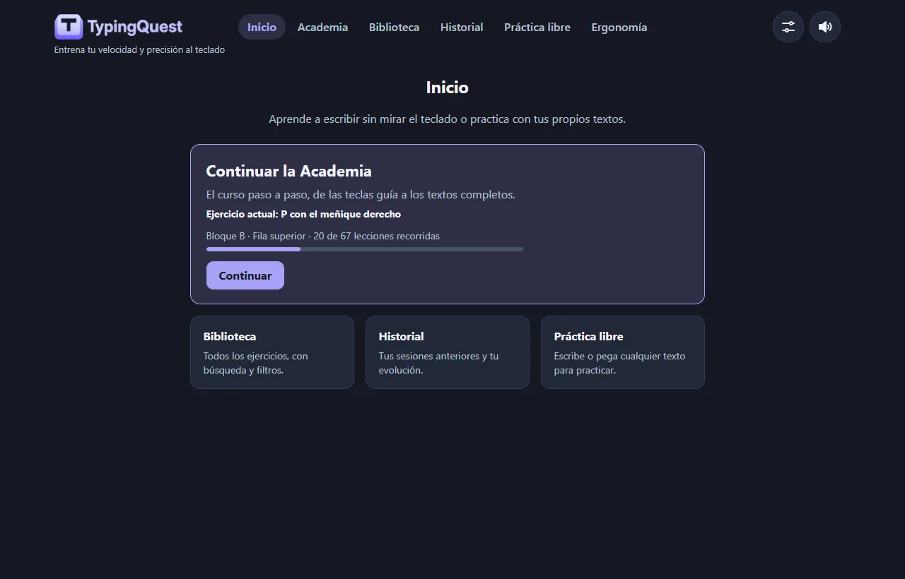
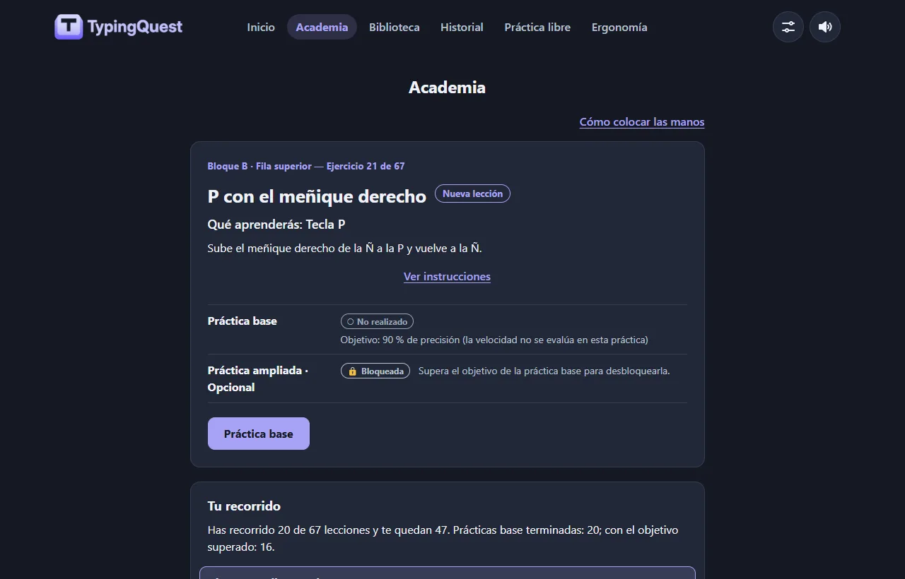
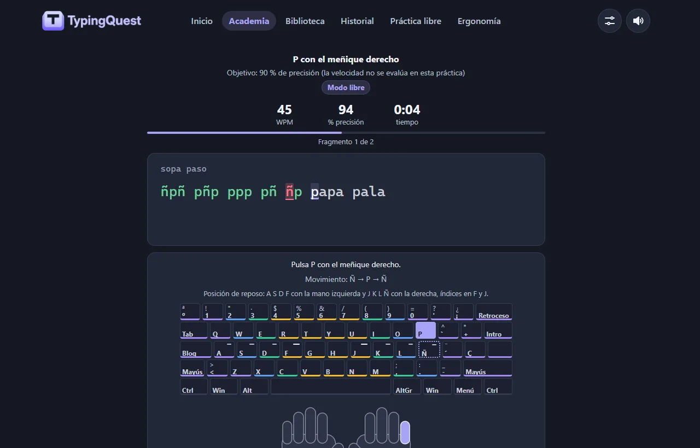
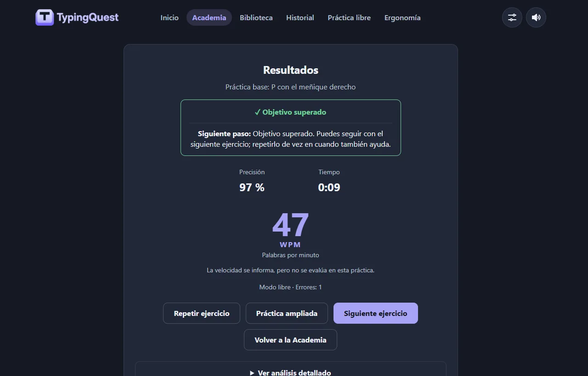
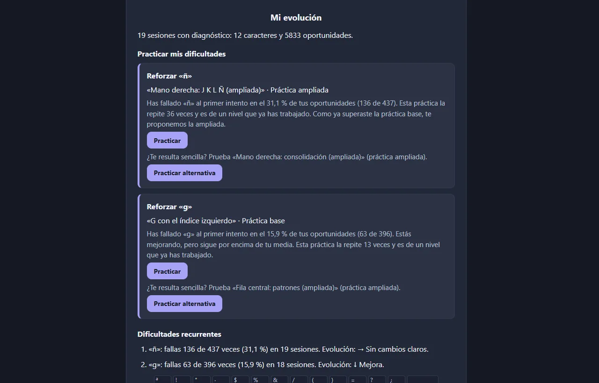
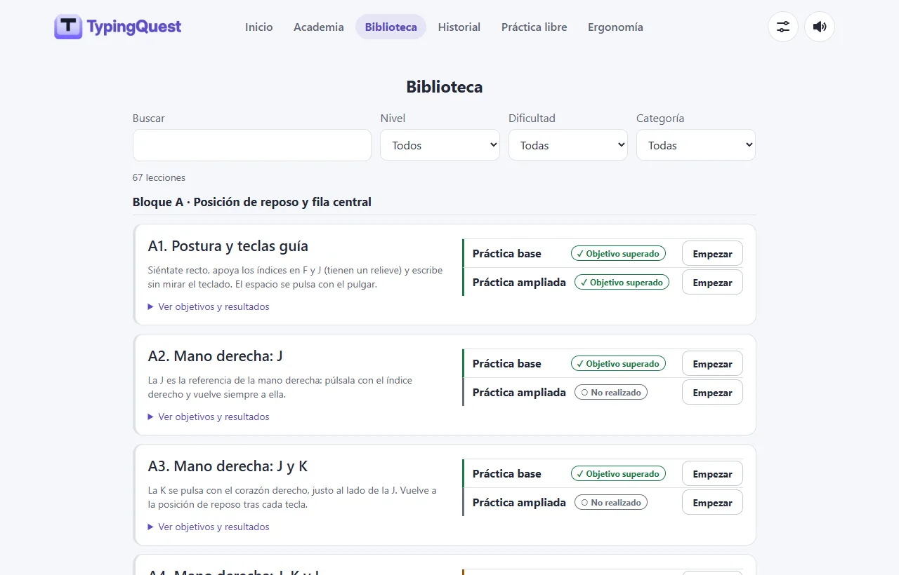
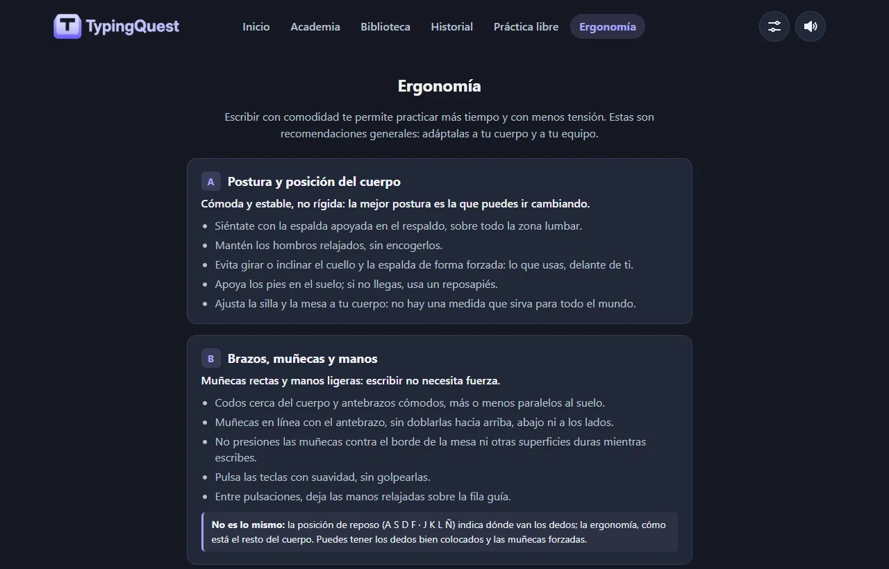
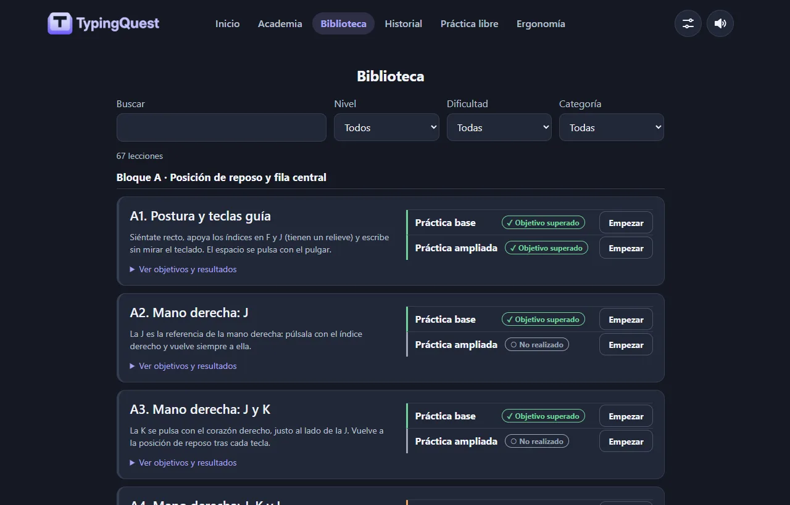
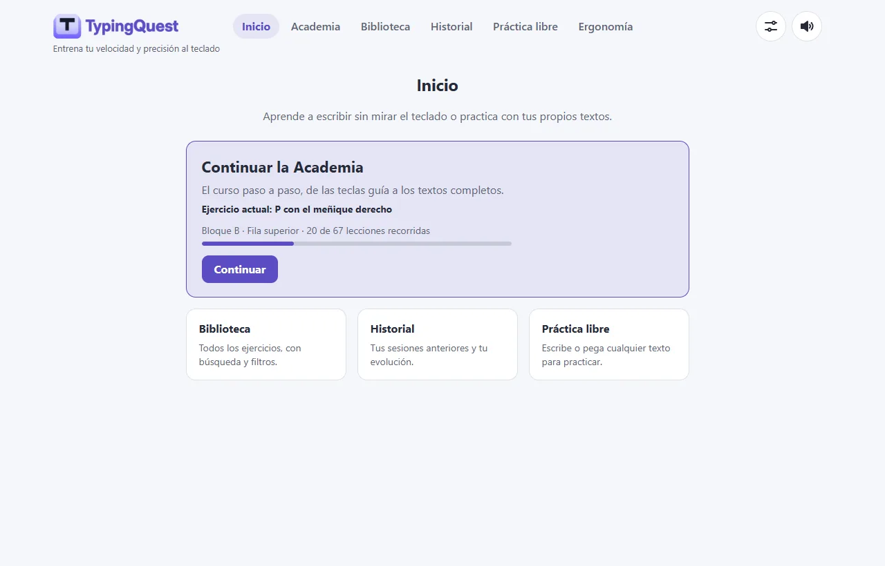

<p align="center">
  
</p>

<p align="center">
  Academia interactiva de mecanografía para el teclado español, hecha con HTML, CSS y JavaScript sin dependencias.
</p>

<p align="center">
  <a href="https://alejandro-mfl.github.io/TypingQuest/"><strong>▶ Probar TypingQuest en el navegador</strong></a>
</p>

---

**TypingQuest** enseña a escribir sin mirar el teclado con un curso progresivo: cada lección
introduce una tecla y el dedo que la pulsa, y una guía visual del teclado y de las manos
acompaña cada pulsación. Mide la precisión y la velocidad, guarda la evolución de cada sesión
y propone qué practicar según los errores de cada carácter, con reglas deterministas y
explicables (sin inteligencia artificial).

Está pensada para quien empieza desde cero con un teclado español (QWERTY ISO) y para quien
ya escribe, pero quiere corregir malos hábitos y ganar velocidad sin perder precisión.

> **Web pública:** <https://alejandro-mfl.github.io/TypingQuest/>. No hace falta instalar ni
> registrarse: funciona en el navegador y guarda los datos solo en tu equipo. Para ejecutarla
> en local, consulta [Ejecución local](#ejecución-local).

## Capturas

Capturas reales de la aplicación (escritorio, 1280 px), con **datos de prueba** generados para
la demostración. Tema oscuro; al final, dos del tema claro.

| Inicio | Academia |
| --- | --- |
|  |  |
| **Pantalla de escritura** | **Resultados** |
|  |  |
| **Mi evolución** | **Biblioteca (tema claro)** |
|  |  |

<details>
<summary>Más capturas: Ergonomía, Biblioteca (tema oscuro) e Inicio (tema claro)</summary>





</details>

## Funcionalidades

**Aprender**

- **Academia progresiva** de 67 lecciones en cinco bloques: posición de reposo y fila central,
  fila superior, fila inferior, mayúsculas, tildes, signos y números, y textos completos.
- **134 prácticas**: cada lección tiene una práctica base, breve, que marca el recorrido, y una
  ampliada opcional, que se desbloquea al superar el objetivo de la base.
- **Aprendizaje por posición de los dedos**: una tecla nueva por lección, primero con una mano,
  luego con la otra y después con las dos, con instrucciones del movimiento («desde J, sube
  hasta U y vuelve a J»).
- **Modelo del teclado español ISO**: Ñ, teclas muertas para tildes y diéresis, Mayús de la
  mano contraria y AltGr.
- **Guía visual** del teclado y de las manos (SVG propio) con la tecla y el dedo recomendados,
  y tres niveles de ayuda.

**Practicar**

- **Biblioteca** con todas las lecciones, búsqueda y filtros por bloque, dificultad y categoría.
- **Práctica libre** con textos propios: se limpian (comillas tipográficas, saltos de línea,
  caracteres invisibles) y se validan antes de jugar.
- Modo libre o modo que **bloquea el avance con errores**.
- **Navegación desde Resultados**: repetir, práctica ampliada, siguiente ejercicio o siguiente
  recomendación, según de dónde venga la práctica.

**Medir y mejorar**

- **Precisión y WPM** en vivo y en los resultados, con objetivos por nivel.
- **Historial de sesiones** con gráficas de WPM y precisión (con su descripción en texto).
- **Análisis de errores por carácter**: fallos al primer intento, correcciones y confusiones
  más frecuentes, marcados sobre el teclado.
- **Mi evolución**: dificultades recurrentes y si mejoran o empeoran con el tiempo.
- **Recomendaciones personalizadas**: hasta tres prácticas del catálogo elegidas con reglas
  locales a partir de esas dificultades.

**Bienestar y personalización**

- **Ergonomía y hábitos saludables**: postura, muñecas, pantalla y descansos, con fuentes
  institucionales (INSST y CCOHS).
- **Temas claro, oscuro y automático**, sin destello al cargar.
- **Datos locales**: progreso, historial, diagnósticos y tema se guardan en el navegador.
- Interfaz en español, accesible con el teclado y respetuosa con `prefers-reduced-motion`.

## Tecnologías

- **HTML5** y **CSS3** (variables para los temas, rejilla y `:has()`), sin frameworks.
- **JavaScript moderno con módulos ES**, sin dependencias ni paso de compilación.
- **SVG** para las manos, las gráficas y los iconos; **Web Audio API** para los sonidos.
- **Web Storage** (`localStorage`) para el progreso y las preferencias.
- **Node.js 22** (`node --test`) para las pruebas automatizadas, sin instalar paquetes.
- **Python 3** (biblioteca estándar) para el servidor local de desarrollo.
- **Git**, **GitHub** y **GitHub Actions** para publicar en **GitHub Pages** (despliegue manual).

No hay backend, base de datos remota, cuentas de usuario, analítica ni servicios de IA.

## Arquitectura

```
index.html        Pantallas y navegación (rutas con #: #/academia, #/biblioteca…)
css/styles.css    Sistema de diseño y temas
data/             Catálogo de ejercicios y organización del curso (JSON)
js/               Módulos ES: motor, lógica pura e interfaz
tests/            Pruebas con el ejecutor nativo de Node
tools/            Servidor local y construcción del artefacto de publicación
docs/             Capturas y guía de publicación
```

- **Motor de escritura independiente de la interfaz.** `game.js` procesa cada entrada y
  devuelve un estado nuevo sin tocar el DOM; `metrics.js` calcula WPM y precisión. La
  interfaz (`ui.js`, `course-ui.js`…) solo pinta, y `main.js` coordina eventos, rutas y
  temporizadores. Casi toda la lógica está en módulos puros que se prueban con Node.
- **Catálogo como datos.** Los ejercicios y el curso viven en JSON y se validan al cargar:
  IDs, objetivos y que cada texto use solo teclas ya enseñadas.
- **Navegación** por rutas hash (`router.js`), compatible con cualquier alojamiento estático.
- **Almacenamiento** a través de un solo módulo (`storage.js`), con formatos versionados,
  validación de lo que se lee y sin lanzar errores si el navegador bloquea el almacenamiento.
- **Estadísticas y recomendaciones** en módulos puros: diagnóstico por carácter
  (`typing-analysis.js`), evolución entre sesiones (`typing-trends.js`) y recomendaciones
  (`recommendations.js`).

## Ejecución local

Requisitos: un navegador actual y **Python 3**. Node.js 22 solo hace falta para las pruebas.

```bash
python tools/dev-server.py
```

Abre <http://localhost:8000>. El servidor solo escucha en tu equipo y evita que el navegador
mezcle versiones antiguas de los módulos en caché.

> No abras `index.html` directamente (`file://`): los módulos ES y la carga de los JSON
> necesitan un servidor.

## Pruebas

```bash
node --test "tests/*.test.js"
```

Lógica del juego y de los datos: motor, métricas, preparación del texto, catálogo y temario
reales, progreso, historial y migraciones, diagnósticos, recomendaciones, rutas, temas,
seguridad (código sin `innerHTML` ni `eval`, CSP, datos manipulados) y el artefacto de
publicación.

```bash
node --test ".claude/hooks/*.test.cjs"
```

Comprobador de sintaxis de JavaScript que el proyecto usa durante el desarrollo.

## Privacidad

- TypingQuest **no tiene cuentas ni servidor propio**: todo se ejecuta en tu navegador.
- Guarda en el `localStorage` de ese navegador el progreso de la Academia, el historial
  (fecha, ejercicio, WPM, precisión, tiempo, errores y modo), el diagnóstico por carácter de
  cada sesión (solo recuentos), el tema y si ya viste las instrucciones.
- **No guarda los textos** que escribes, tampoco los de la práctica libre.
- La única red que usa es la carga de sus propios archivos. No hay analítica ni cookies.
- Los datos no se sincronizan entre dispositivos y **se pierden si borras los datos del
  navegador** o usas una ventana privada.

## Limitaciones conocidas

- Probada sobre todo en Chromium. Faltan pruebas manuales en Firefox, Safari y Brave, con
  lectores de pantalla reales y con un teclado físico español.
- Algunos métodos de entrada que entregan varios caracteres a la vez (IME de chino o japonés,
  ciertos teclados Android) no son compatibles.
- Sonido, modo de escritura y nivel de ayuda no se guardan entre recargas.
- Los objetivos por nivel y los umbrales de las recomendaciones son provisionales.
- Para desarrolladores: el motor compara el prefijo escrito y depende de que la interfaz
  imponga una escritura secuencial (TODO «H2» en `tests/game.test.js`).

## Autoría y licencia

Desarrollado por [Alejandro-MFL](https://github.com/Alejandro-MFL).

- **Código:** licencia [MIT](LICENSE). Puedes usarlo, modificarlo y redistribuirlo
  conservando el aviso de copyright y de licencia.
- **Nombre y logotipos:** quedan **fuera** de la licencia MIT. `assets/logo.webp`,
  `assets/logo-wordmark.webp` y la identidad de marca «TypingQuest» no se autorizan para
  reutilizarse; los proyectos derivados deben usar otro nombre y otros logotipos. Detalles en
  [TRADEMARKS.md](TRADEMARKS.md).
